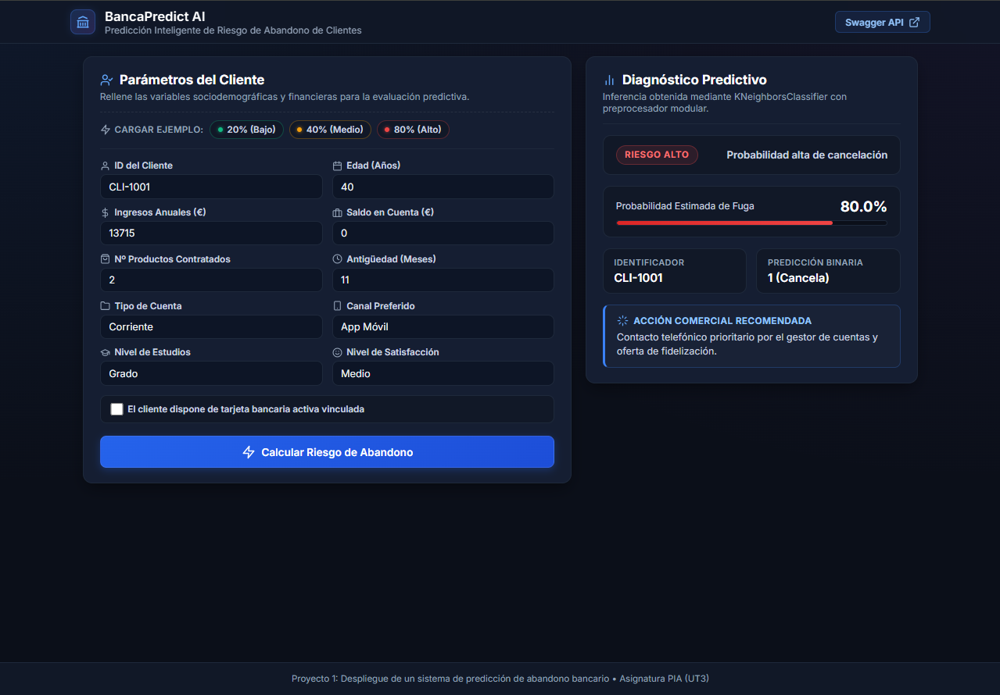

# Despliegue en Producción - Predicción de Abandono Bancario

**Proyecto 1:** Despliegue de un sistema de predicción de abandono bancario  
**Autor:** Alejandro Andrés  
**Asignatura:** Programación de Inteligencia Artificial (UT3)

---

## 1. URL Pública de la Aplicación

La aplicación se encuentra desplegada y activa en Render:

- **Interfaz Web:** [https://p01-alejandroandres.onrender.com](https://p01-alejandroandres.onrender.com)
- **Documentación Interactiva (Swagger UI):** [https://p01-alejandroandres.onrender.com/docs](https://p01-alejandroandres.onrender.com/docs)

---

## 2. Instrucciones Breves de Uso

### 2.1. Interfaz Web (`/`)

1. Accede a [https://p01-alejandroandres.onrender.com/](https://p01-alejandroandres.onrender.com/).
2. Completa el formulario con los datos de un cliente (ejemplo: Edad: `42`, Ingresos: `48000`, Saldo: `14200`, Nº Productos: `2`, Antigüedad: `60`, Tipo de cuenta: `Ahorro`, etc.).
3. Haz clic en **Calcular Riesgo de Abandono**.
4. Se mostrará el resultado con la probabilidad de abandono, el nivel de riesgo asignado y la recomendación comercial correspondiente.

### 2.2. Documentación Swagger (`/docs`)

1. Entra en [https://p01-alejandroandres.onrender.com/docs](https://p01-alejandroandres.onrender.com/docs).
2. Despliega el endpoint **`POST /predict`** y pulsa en **Try it out**.
3. Pega el siguiente payload JSON en el cuerpo de la petición:

```json
{
  "id_cliente": "CLI-8492",
  "edad": 42,
  "ingresos_anuales": 48000.0,
  "saldo_cuenta": 14200.0,
  "num_productos": 2,
  "antiguedad_meses": 60,
  "tiene_tarjeta": 1,
  "tipo_cuenta": "Ahorro",
  "canal_preferido": "App Movil",
  "nivel_estudios": "Grado",
  "nivel_satisfaccion": "Alto"
}
```

4. Pulsa **Execute** y comprueba la respuesta (`200 OK`) con la predicción:

```json
{
  "id_cliente": "CLI-8492",
  "abandono": 0,
  "probabilidad_abandono": 0.2,
  "nivel_riesgo": "Bajo",
  "accion_recomendada": "Sin acción requerida. Cliente fidelizado."
}
```

---

## 3. Captura de Pantalla de la Interfaz en Producción

Aplicación desplegada en producción:


