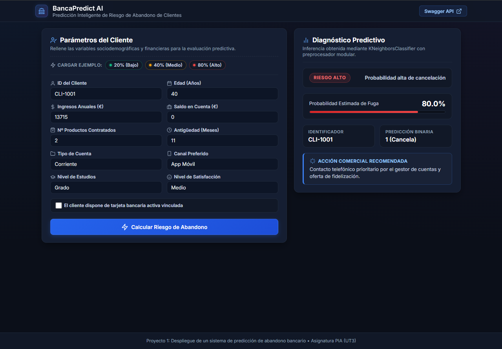

# Guía de Despliegue y Puesta en Producción

**Proyecto 1:** Despliegue de un sistema de predicción de abandono bancario  
**Autor:** Alejandro Andrés  
**Asignatura:** Programación de Inteligencia Artificial (UT3)

---

## 1. Enlace de la Aplicación en Producción

La web está preparada para su ejecución y despliegue público en la nube:

- **URL de la Aplicación:** `FALTA POR HACER`
- **Documentación Swagger UI:** `FALTA POR HACER`

---

## 2. Instrucciones de Ejecución en Local

Para probarlo en local antes de desplegarlo en la nube, sigue estos pasos:

### 2.1. Requisitos Previos y Entorno Virtual

Desde la raíz del repositorio (`p01_alejandroandres`), activa tu entorno virtual:

```bash
# Creación del entorno
python -m venv venv

# Activación en Windows:
.\venv\Scripts\Activate.ps1
# O en CMD:
venv\Scripts\activate.bat

# Activación en Linux / macOS:
source venv/bin/activate
```

### 2.2. Instalación de Dependencias

Instala los paquetes necesarios desde la raíz del proyecto apuntando al archivo de requerimientos:

```bash
pip install -r .\api_abandono_banca\requirements.txt
```

### 2.3. Inicio del Servidor Uvicorn

Para arrancar el servidor correctamente y que localice los módulos y artefactos (`artifacts/`), accede a la subcarpeta `api_abandono_banca` y ejecuta Uvicorn:

```bash
cd api_abandono_banca
uvicorn main:app --reload --port 8000
```

- Interfaz web: [http://127.0.0.1:8000/](http://127.0.0.1:8000/)
- Documentación Swagger: [http://127.0.0.1:8000/docs](http://127.0.0.1:8000/docs)

---

## 3. Guía Paso a Paso para el Despliegue en Render

1. **Crear Repositorio en GitHub:**
   - Sube la carpeta del backend a un nuevo repositorio.

2. **Crear Web Service en Render:**
   - Inicia sesión en [Render.com](https://render.com).
   - Pulsa en **New +** y selecciona **Web Service**.
   - Conecta tu repositorio de GitHub.

3. **Configuración del Servicio:**
   - **Name:** `api-abandono-banca-alejandroandres`
   - **Language:** `Python 3`
   - **Root Directory:** `api_abandono_banca`.
   - **Build Command:** `pip install -r requirements.txt`
   - **Start Command:** `uvicorn main:app --host 0.0.0.0 --port $PORT`
   - **Instance Type:** `Free`

4. **Despliegue Automático:**
   - Pulsa en **Create Web Service**. Render instalará las dependencias y levantará la aplicación asignándole un subdominio público HTTPS.

---

## 4. Pruebas y Validación de la Inferencia

### 4.1. Prueba Interfaz Web (`/`)

1. Accede a la URL raíz de la aplicación.
2. Introduce los datos de un cliente en el formulario:
   - **ID del Cliente:** `CLI-8492`
   - **Edad:** `42`
   - **Ingresos Anuales:** `48000`
   - **Saldo en Cuenta:** `14200`
   - **Nº Productos:** `2`
   - **Antigüedad:** `60` meses
   - **Tipo de Cuenta:** `Ahorro`
   - **Canal:** `App Movil`
   - **Nivel de Estudios:** `Grado`
   - **Satisfacción:** `Alto`
   - **Tiene Tarjeta:** Marcado
3. Pulsa **Calcular Riesgo de Abandono**.
4. El sistema devolverá el diagnóstico inmediato con la probabilidad calculada, la insignia visual de color (Riesgo Bajo, Medio o Alto) y la recomendación comercial asociada.

### 4.2. Prueba Documentación Swagger (`/docs`)

1. Entra en `/docs`.
2. Despliega el endpoint `POST /predict`.
3. Haz clic en **Try it out**.
4. Envía el siguiente JSON de ejemplo:

```json
{
  "id_cliente": "CLI-8492",
  "edad": 42,
  "ingresos_anuales": 48000.0,
  "saldo_cuenta": 14200.0,
  "num_productos": 2,
  "antiguedad_meses": 60,
  "tiene_tarjeta": 1,
  "tipo_cuenta": "Ahorro",
  "canal_preferido": "App Movil",
  "nivel_estudios": "Grado",
  "nivel_satisfaccion": "Alto"
}
```

5. Pulsa **Execute** y verifica el código `200 OK` con la respuesta:

```json
{
  "id_cliente": "CLI-8492",
  "abandono": 0,
  "probabilidad_abandono": 0.2,
  "nivel_riesgo": "Bajo",
  "accion_recomendada": "Sin acción requerida. Cliente fidelizado."
}
```

---

## 5. Capturas de Pantalla de la Aplicación en Producción

A continuación se muestra la interfaz web:

